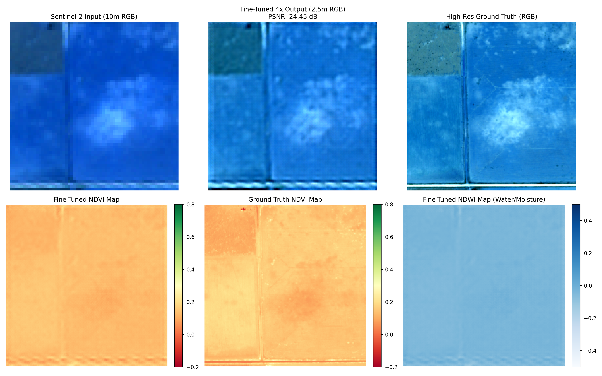
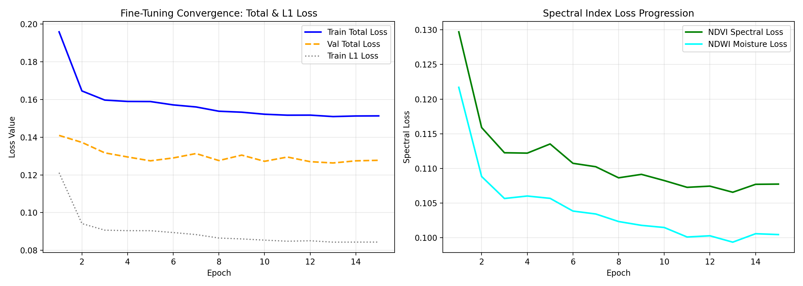

# Sentinel-2 Spectral Enhancement and Super-Resolution (SEN2SR)

This project focuses on enhancing the spatial resolution of multispectral Sentinel-2 satellite imagery from 10 meters down to 2.5 meters (4x super-resolution) while preserving critical surface reflectance and multispectral indices like NDVI, NDWI, and NDBI.

---

## Overview

Sentinel-2 provides free global multispectral imagery, but its spatial resolution is limited to 10m for visible/NIR bands and 20m for Red Edge/SWIR bands. At 10m resolution, small buildings, farm plot boundaries, narrow roads, and river shorelines often look pixelated and blurry.

Standard super-resolution models trained only with pixel-wise L1 or L2 loss can introduce blurry edges or distort spectral indices. In this project, we use SEN2SR Lite combined with a compound loss function:
- **L1 Reconstruction Loss**: Maintains base radiometric accuracy.
- **Sobel Edge Loss**: Sharpens spatial high-frequency transitions (roads, shorelines, field parcel edges).
- **NDVI & NDWI Spectral Index Losses**: Prevents color and vegetation/water index distortion.

The resulting model upscales 10m Sentinel-2 imagery to 2.5m resolution with sharper boundaries and consistent spectral indices.

---

## What Is in This Repository

- **`notebooks/`**: Organized step-by-step notebooks:
  - **`01_data_preparation/`**: Data download and preparation scripts for SEN2NAIP and WorldStrat benchmark datasets.
  - **`02_baseline_inference/`**: Setup verification and baseline inference using pretrained SEN2SR Lite and Full models.
  - **`03_methodology_docs/`**: Detailed mathematical formulation of the compound loss function and project methodology.
  - **`04_finetuning_experiments/`**: Training notebook (`Train_SEN2SR_Lite_Compound_Loss.ipynb`) and 3-way evaluation notebook (`SEN2SR_Baseline_vs_Finetuned_Comparison.ipynb`) comparing native 10m input, baseline 2.5m, and fine-tuned 2.5m outputs.
  - **`05_ultra_highres_1m_experiments/`**: Optional experimental cascaded refinement notebooks exploring sub-2m upscaling.
- **`docs/COPERNICUS_DOWNLOAD_GUIDE.md`**: Guide explaining how to select, filter, and export cloud-free 10-band Sentinel-2 Level-2A GeoTIFFs from the Copernicus Data Space Browser.
- **`docs/LITERATURE_REVIEW.md`**: In-depth theoretical foundations covering the mathematics of multispectral super-resolution, compound loss formulations, and remote sensing evaluation metrics.
- **`results/`**: Validation comparison figures, training loss curves, spectral difference heatmaps, and quantitative metric CSVs.
- **`requirements.txt`**: Python dependencies needed to run the project.

---

## What Is Not in This Repository

To keep the repository fast and lightweight:
- **Raw satellite imagery**: Large multi-gigabyte `.zip` and `.tif` files are excluded.
- **Full training datasets**: The 40GB+ WorldStrat and SEN2NAIP archives are not stored in Git.
- **Model weight checkpoints (`.pth` files)**: Model checkpoints are saved locally or in Google Drive during training.

The notebooks are designed to download necessary pre-trained weights automatically or read dataset archives directly from a mounted Google Drive folder.

---

## How to Get Started

### Option 1: Running in Google Colab (Recommended)

1. **Get an analytical Sentinel-2 scene:**
   Follow [docs/COPERNICUS_DOWNLOAD_GUIDE.md](docs/COPERNICUS_DOWNLOAD_GUIDE.md) to download a cloud-free 10-band Level-2A ZIP archive from Copernicus Browser.
2. **Upload to Google Drive:**
   Save the downloaded `.zip` file in your Google Drive under:
   ```text
   Project_Folder/Datasets/Browser_images_1.zip
   ```
3. **Run the comparison notebook:**
   Open `notebooks/04_finetuning_experiments/SEN2SR_Baseline_vs_Finetuned_Comparison.ipynb` in Google Colab, mount Google Drive, and run all cells. It will extract the imagery, run inference, and display side-by-side visual comparisons, spectral index maps, and metric tables.

### Option 2: Running Locally

1. **Clone the repository:**
   ```bash
   git clone https://github.com/ANMOLRAWAT990/sen2sr-spectral-enhancement.git
   cd sen2sr-spectral-enhancement
   ```

2. **Create a virtual environment and install requirements:**
   ```bash
   python -m venv venv
   # Linux / macOS:
   source venv/bin/activate
   # Windows:
   venv\Scripts\activate

   pip install -r requirements.txt
   ```

3. **Start Jupyter:**
   ```bash
   jupyter lab
   ```
   Open any notebook from the `notebooks/` directory to run experiments.

---

## Results Preview

### Spatial and Spectral Comparison (10m vs. 2.5m)
Comparison of native Sentinel-2 input against the fine-tuned model on validation data:



- Road networks, canal lines, and field boundaries show improved spatial definition.
- NDVI (vegetation) and NDWI (water) indices retain accurate physical index values without edge bleeding.

### Training Loss Curves
Progression of total loss, L1 pixel error, and spectral index losses during fine-tuning:



---

## Repository Structure

```text
sen2sr-spectral-enhancement/
├── docs/
│   ├── COPERNICUS_DOWNLOAD_GUIDE.md
│   └── LITERATURE_REVIEW.md
├── notebooks/
│   ├── 01_data_preparation/
│   │   ├── Download_and_Extract.ipynb
│   │   ├── Download_SEN2NAIP.ipynb
│   │   └── Extract_WorldStrat_HighRes.ipynb
│   ├── 02_baseline_inference/
│   │   ├── SEN2SR_Lite_Setup.ipynb
│   │   ├── SEN2SR_Lite_Spectral_Comparison.ipynb
│   │   └── SEN2SR_Full_Spectral_Comparison.ipynb
│   ├── 03_methodology_docs/
│   │   └── SEN2SR_Methodology_and_FineTuning_Guide.ipynb
│   ├── 04_finetuning_experiments/
│   │   ├── Train_SEN2SR_Lite_Compound_Loss.ipynb
│   │   └── SEN2SR_Baseline_vs_Finetuned_Comparison.ipynb
│   └── 05_ultra_highres_1m_experiments/
│       ├── README.md
│       ├── Train_1Meter_Cascaded_Refiner.ipynb
│       └── SEN2SR_1Meter_4Way_Comparison.ipynb
├── results/
│   ├── SEN2SR_Joint_Validation_Comparison.png
│   ├── SEN2SR_Training_Loss_Curve.png
│   ├── SEN2SR_10Band_3Way_Comparison.png
│   ├── SEN2SR_10Band_Difference_Maps.png
│   └── SEN2SR_10Band_Benchmark_Metrics.csv
├── requirements.txt
└── README.md
```
