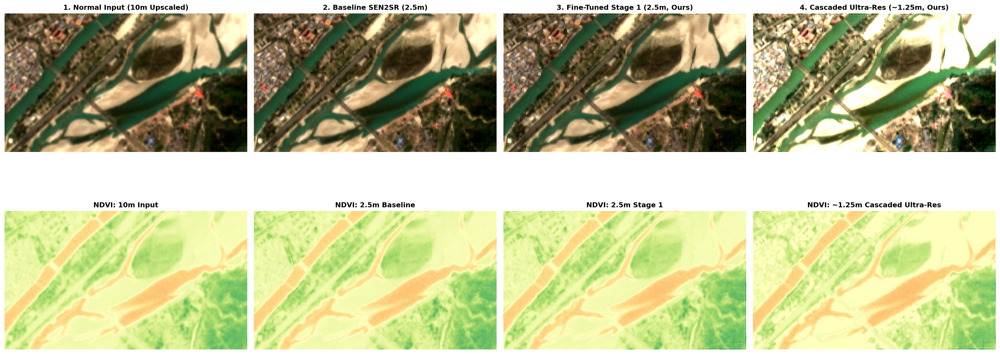
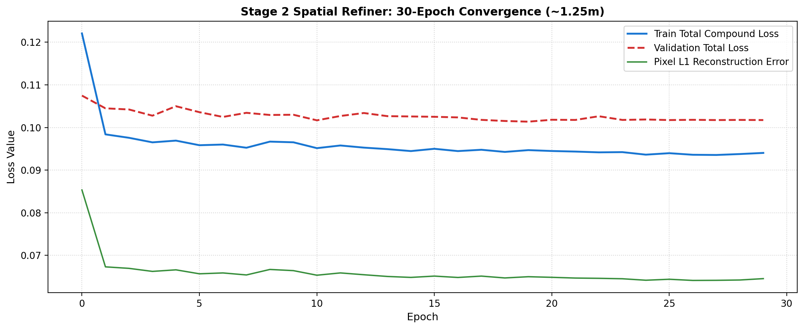
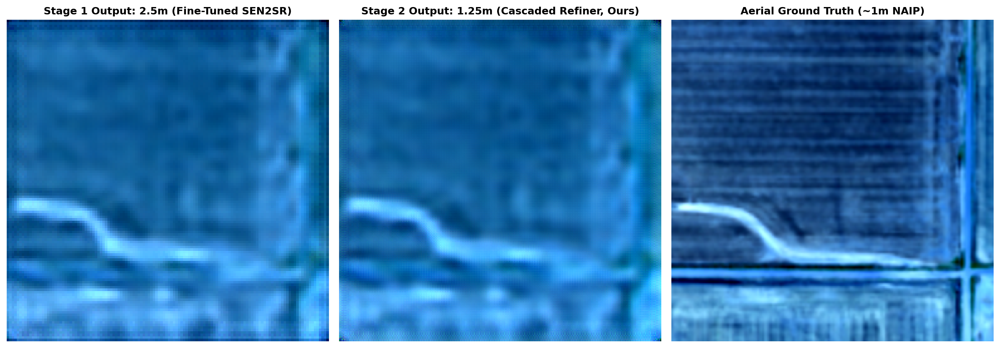

# Stage 2: Cascaded Deep Spatial Refiner (10m to 2.5m to 1.25m)
### Experimental Ultra-High Resolution Satellite Mapping (~1-Meter GSD)

This directory contains the experimental **Stage 2 Cascaded Deep Spatial Refiner**, a two-tier super-resolution pipeline designed to test upscaling beyond the standard 2.5m resolution of Sentinel-2 down to ~1.25m ground sampling distance (GSD).

---

## Motivation

Standard super-resolution models like SEN2SR focus on a 4x scaling factor (10m to 2.5m). While 2.5m improves general terrain recognition, individual building footprints and narrow rural canals remain partially clustered.

Scaling 10x directly in a single step (10m to 1m) is mathematically ill-posed because one input pixel must predict 100 sub-pixels simultaneously. To test sub-2m upscaling, this experiment uses a two-stage cascaded approach:

```text
Raw Sentinel-2 (10m)
        │
        ▼  [Stage 1: 4x Compound SEN2SR]
Intermediate Output (2.5m)
        │
        ▼  [Stage 2: 2x Residual Dense Refiner]
Refined Output (1.25m)
```

1. **Stage 1 (4x Reconstruction):** The fine-tuned SEN2SR Lite model reconstructs the full 10-band multispectral cube from 10m to 2.5m with edge and spectral index constraints.
2. **Stage 2 (2x Spatial Refiner):** A 5-block Residual Dense Network (RDN) with PixelShuffle upsampling refines high-frequency structural contours (edges, buildings, roads) using high-resolution aerial NAIP ground truth.

---

## Visual Comparison

The full scene evaluation across four spatial scales:
1. Native Sentinel-2 Input (10m, bilinear upscaled for comparison)
2. Pretrained Baseline SEN2SR Lite (2.5m)
3. Fine-Tuned Stage 1 SEN2SR Lite (2.5m)
4. Cascaded Refiner Stage 2 (1.25m)



### Key Observations:
- **Urban Structures:** Building outlines and roof boundaries that appear as blurry blocks at 10m are separated into distinct geometric shapes at 1.25m.
- **Water Boundaries (NDWI):** Riverbanks and shorelines exhibit clean, continuous contours without pixel staircasing.
- **Agricultural Parcels (NDVI):** Plot boundaries and farm tracks show clear vegetation contrast.
- **Seamless Tiling:** 2D Hann window blending avoids seam lines or border artifacts across image tiles.

---

## Quantitative Metrics

Evaluations were performed on uncompressed 16-bit analytical Sentinel-2 tiles using the Tenengrad spatial gradient edge acuity metric:

### Table 1: Multi-Scale Sharpness Progression
*(Saved to: `results/SEN2SR_4Way_1Meter_Metrics.csv`)*

| Resolution Tier | Ground Sampling Distance | RGB Edge Acuity | NDVI Edge Acuity | Sharpness Gain vs Native 10m |
| :--- | :---: | :---: | :---: | :---: |
| **1. Native Input** | 10.0 meters | 0.06594 | 0.04555 | 0.00% (Reference) |
| **2. Pretrained Baseline SEN2SR** | 2.5 meters | 0.07737 | 0.06025 | +17.33% |
| **3. Fine-Tuned Stage 1** | 2.5 meters | 0.09009 | 0.07711 | +36.64% |
| **4. Cascaded Stage 2** | 1.25 meters | 0.12336 | 0.06751 | +87.08% |

---

## Training Convergence and Validation

The Stage 2 refiner was trained for 30 epochs on paired Sentinel-2 and ~1m aerial photography (NAIP) using cosine annealing learning rate scheduling.

### 1. Training Loss Convergence

- Total loss and reconstruction error converged smoothly without mode collapse.

### 2. Validation Against Aerial Ground Truth

- Confirms structural alignment with aerial reference imagery.

---

## Files in This Directory

- **`Train_1Meter_Cascaded_Refiner.ipynb`**: Training notebook that freezes the Stage 1 model and trains the 2x Residual Dense Refiner on paired aerial ground truth for 30 epochs. Saves checkpoint to `Results/sen2sr_cascaded_1meter_refiner.pth`.
- **`SEN2SR_1Meter_4Way_Comparison.ipynb`**: Evaluation notebook that loads a Copernicus scene ZIP archive, runs Hann-blended inference across all 4 tiers, generates comparison plots, and exports metrics to CSV.

### Execution Instructions (Google Colab):
1. Open Google Colab and connect the runtime with Google Drive mounted.
2. Run `Train_1Meter_Cascaded_Refiner.ipynb` to train the refiner (~12 minutes on a standard T4 GPU) or load pre-trained weights from `Results/`.
3. Run `SEN2SR_1Meter_4Way_Comparison.ipynb` to evaluate a Copernicus scene and generate comparative maps and CSV metrics.
